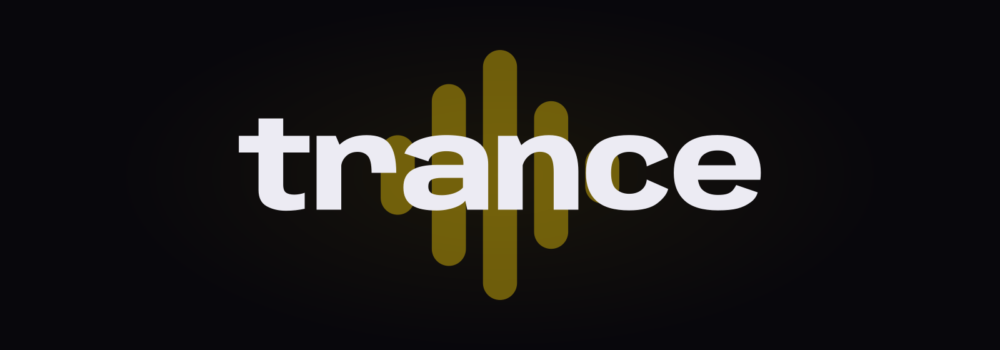

<p align="center">
  <a href="https://trance.eoschaos.com"></a>
</p>

A music visualizer for Linux and Windows 11. It listens to whatever your
speakers play and draws it: feedback tunnels, flow fields, wireframe
landscapes and particle storms, or plain analyzers when that's all you want.
Every preset can be changed while it runs. See them move on
[the website](https://trance.eoschaos.com).


- **144 presets** built in, changing on the beat. A change is not a cut: for
  a few seconds both presets run on the one picture, and the wave of one
  reshapes itself into the wave of the next. Search them, filter them by
  color or by what they are made of, gather them into lists of your own,
  and keep the changes to what matches.
- **A layer for every part of the sound.** Besides bass, mid and treble,
  formulas can follow six narrower ranges (`sub`, `low`, `lowmid`,
  `highmid`, `presence`, `air`), so each layer of a preset moves to its own.
- **Wireframes in space.** The last few seconds of the spectrum as a sheet
  of lines, laid flat like a sea, rolled into a tube, spread into a ring or
  wrapped round a ball, folding from one form into another while a camera
  turns round it, or shaped by its own code into hills and a road running
  to the horizon. Thirty presets are built on it.
- **Everything works on everything else.** Flow fields bend the picture,
  waves and bars throw particles, the particles ride the flow, and one
  palette colors all of it.
- **Light that doesn't burn out.** A layer's light covers what is under it,
  adds to it, or keeps the brighter of the two, which glows however long
  the picture takes to fade but never grows past the layer's own color, and
  light that piles up keeps its hue instead of turning white.
  With it, presets such as Spillway and Ink Well fill the whole screen with
  color the way G-Force does. The picture is as bright at 120 or 144 Hz as
  at 60.
- **Listen to one app.** Everything that's playing, or only Spotify, or only
  your browser. It goes on playing through your speakers, with no virtual
  cables or rerouting.
- **Edit anything live.** Press `E`: every setting has a plain name, a
  slider and an explanation, and any number can instead be a formula of the
  music, such as `1.02 + 0.05*bass_att`. Nothing is written until you save.
- **Your colors.** `T` recolors every preset with your desktop theme's
  colors on [Omarchy](https://omarchy.org), or with one of 65 palettes.
- **Glass.** `G` makes black see-through, so your desktop shows behind the
  picture.
- **Mash-ups and visitors.** `X` builds a new preset from parts of others,
  the motion from one, the layers from another, the look and the
  background from two more; how bright it gets, and whether it is colored
  by brightness, goes with the layers, so a mash-up is as balanced as the
  presets it came from. Small extras drop in
  over any preset for a while: a comet, fireflies, a ripple on every kick.
- **Track titles** from whatever player is running, in the corner or written
  into the picture for the flow to carry off.
- **Light on the processor.** The picture is drawn on the graphics card, and
  a laptop's integrated graphics draw a 1080p frame in about 2 ms on average
  across the presets.

## Install

On Linux:

```sh
bin/install
```

On Arch and Omarchy this builds a package and installs it with pacman; on
any other distribution it builds and runs `sudo make install` into
`/usr/local`. Either way Trance is then in the app launcher. To try it
without installing:

```sh
bin/build && build/trance
```

It needs:

- Qt 6.8 or newer, with Qt Quick, Quick Controls and the Wayland platform
  plugin (on Arch: `qt6-base qt6-declarative qt6-wayland`, which Omarchy
  already has), and a C++17 compiler with `make` to build it.
- PipeWire with its `pw-cat` and `pw-dump` tools, which is how it hears the
  music. Most current distributions play sound through PipeWire already.
- A graphics driver with OpenGL 3.3.

Track titles come from any player that speaks MPRIS. Two things are only
there on the desktops that have them: the theme's colors on Omarchy, and
corners that follow the window rounding on Hyprland.

## Windows

Trance runs on Windows 11 24H2 or later, on x64, as fully as on Linux. Each change is
built and tested on GitHub.

### Installing it

Each [release](https://github.com/insomniarox/trance/releases) comes two
ways, and both bring Qt and Microsoft's C++ runtime along, so nothing has
to be installed first:

- **`trance-<version>-setup.exe`**, the installer. It installs for you
  alone, into `%LOCALAPPDATA%\Programs\Trance`, without asking for an
  administrator, and puts Trance in the Start menu (and on the desktop if
  you tick it). It also tells Windows where `trance.exe` is, so
  `trance next` works from Run (Win+R) and from AutoHotkey without a
  path. A newer one installs over it; Settings > Apps uninstalls it.
- **`trance-<version>-windows-x64.zip`**, to unzip anywhere and start
  `trance\trance.exe`, with nothing written outside that folder.

Windows may warn that it doesn't know the installer ("Windows protected
your PC"), because it isn't signed yet: "More info", then "Run anyway".
Either way, settings and your presets are kept in `%LOCALAPPDATA%\trance`,
and uninstalling leaves them there.

Every build on GitHub also leaves both, between releases: open the
[Windows runs](https://github.com/insomniarox/trance/actions/workflows/windows.yml),
pick the newest green one, and download `trance-release` under Artifacts
(GitHub asks you to sign in for that).

On Windows before 24H2 the installer refuses, and the zip's Trance opens a
console window beside its own; that version is not supported.

### Building it

It needs:

- Visual Studio 2022 or later with the C++ build tools: the free Build
  Tools for Visual Studio will do, with "Desktop development with C++",
  which brings the Windows SDK.
- Qt 6.8 or newer for MSVC 2022 64-bit, from Qt's online installer. The
  build finds it under `C:\Qt` by itself; elsewhere, set `QTDIR` to the
  kit, as in `C:\Qt\6.8.3\msvc2022_64`.
- A graphics driver with OpenGL 3.3, which every current one has.
- For the installer only, [Inno Setup](https://jrsoftware.org/isinfo.php) 6
  (`winget install JRSoftware.InnoSetup`).

Then, in PowerShell:

```powershell
git clone https://github.com/insomniarox/trance
cd trance
Set-ExecutionPolicy -Scope CurrentUser RemoteSigned   # once: lets the build scripts run
bin\build.ps1      # builds build\trance.exe
bin\test.ps1       # the tests
bin\package.ps1    # dist\trance: the program and all it needs, and a zip of it
bin\installer.ps1  # dist\trance-<version>-setup.exe, with Inno Setup 6
dist\trance\trance.exe
```

`build\trance.exe` also runs straight away in the window that built it,
which has Qt on its path. Commands work the same as on Linux, from
PowerShell or the Command Prompt: `trance.exe next`, `trance.exe sources`,
`trance.exe render ...` (for `--audio`, `ffmpeg` has to be on the path).

### What is different there

- **Listening.** Everything that's playing is every application but
  Trance, on every output at once. An application is called by its
  program's name: `chrome`, `msedge`, `firefox`, `Spotify`. As on Linux it
  goes on playing through your speakers, and nothing is rerouted. Devices
  go by the names Windows shows, and Voicemeeter buses and virtual cables
  are among them as ordinary inputs and outputs. If Windows keeps
  applications from the microphone (Settings > Privacy & security >
  Microphone), Trance says so.
- **Track titles** come from Windows' media controls, the same list as
  the media flyout by the volume keys: Spotify, the browsers and Windows'
  Media Player report there. Players that don't, such as VLC, show no
  title.
- **Colors.** There is no desktop theme to follow, so "theme" is the
  built-in set; the 65 palettes are the same everywhere.
- **Key bindings.** `trance.exe next` and the others work from any tool
  that runs a command on a key, such as PowerToys' Keyboard Manager or
  AutoHotkey.

## Shortcuts

| Key | |
|---|---|
| `Space` | Next preset |
| `Backspace` | Previous preset |
| `R` | Random preset |
| `X` | Mash up a new preset from parts of others |
| `L` | Hold this preset, or let it change again |
| `H` | Put this preset in Favorites, or take it out |
| `K` | Skip this preset and move on, or let it back in |
| `P` | Browse presets |
| `/` | Search presets by name |
| `E` | Edit this preset: its motion, layers and look |
| `S` | Settings: what applies to every preset |
| `D` | Debug overlay: preset, frame rate and load, sound and levels |
| `T` | Change the colors: theme, palettes, or the preset's own |
| `G` | Glass: let the desktop show through |
| `N` | Track titles: in the corner, in the picture, or off |
| `M` | Listen to the microphone instead |
| `+` `-` | More or less sensitive to the music |
| `F` or `F11` | Full screen (also a double-click) |
| `Ctrl+Tab` | In the editor: the next tab |
| `Ctrl+S` | Save the preset |
| `Ctrl+Shift+S` | Save a copy under a new name |
| `Ctrl+N` | New preset |
| `Ctrl+Z` `Ctrl+Shift+Z` | Undo, redo |
| `Esc` | Close what is on top: a menu, a question, the list, a panel; or leave full screen. In a box, put back what was there |
| `?` | Show every shortcut |
| `A` | About Trance: its version, the system it runs on, where your presets are |
| `Q` | Quit |

In the editor, double-click a setting's name to put it back to its default.

## Settings and presets

There are two panels, and they don't overlap:

- **Settings** (`S`) belong to the app and hold whatever preset is showing:
  what to listen to and how sensitively, how often presets change and how
  they blend, one palette for everything, glass, detail, picture size (up to
  1440p, or up to 4K for a 4K screen), and what is shown over the picture.
- **The preset editor** (`E`) changes the one preset on screen, and what it
  changes is saved with that preset: its motion, its layers, its look, or
  the whole thing as JSON. `Ctrl+Tab` moves between those.

The preset list (`P`) is on the left. `/` opens it with the cursor in its
search box: type to find a preset by name, then `Enter` to show it, or
`Esc` to give the keys back to the shortcuts.
Under the search, the round swatches filter by the colors of a preset's
palette: reds and pinks, oranges and yellows, greens, blues and teals,
violets, many colors, grays, or the desktop theme's. The chips filter by
what a preset is made of: a kind of layer, or **Six ranges** for presets
that move with one narrow range of the sound. A preset must have every
chip that is lit. Both are read from the presets themselves, so a new
palette, or a preset of your own, is sorted as soon as it is saved.

Below them are your lists, picked the same way. **Favorites** is always
there: the star beside a preset in the list puts it in or takes it out, and
so does `H` for the one showing. Right-click a preset to put it in any list,
or in a new one, and right-click a list to rename or delete it; `+` starts
an empty one. A preset stays in its lists when you rename it. The lists are
kept in `lists.json`, beside the settings.

**Skipped** is always there too, for presets you'd rather not see: the
button beside the star puts one in or takes it out, and `K` skips the one
showing and moves on, or lets it back in. A skipped preset never
comes by itself, by `Space`, `Backspace`, `R` or the timer, and no mash-up
borrows from it, even from a list the changes are kept to; picked from the list, it
still shows. Cycling through Skipped itself is the one way to have them
come round. Skip everything and everything comes back, rather than nothing.

**Cycle through these only** keeps every change among the presets that
match, a list's included: the ones that come by themselves, `Space`, `Backspace`, `R` and
mash-ups, and with **Colors drift** on, the colors stay in the chosen
family. Picking a preset from the list still shows any preset. The
filters are remembered between runs; **Clear** lets everything back in.

Nothing is written over the picture unless you ask for it. Preset names on
a change are off by default (Settings > On screen), and `D` brings up a
debug overlay, small and see-through over the picture, in four groups:

- the preset: its layers and how each one's light meets what is under it,
  the decay, zoom, turn and bloom it is running at this frame (formulas
  worked out), the colors, which visitors are in, where a mash-up's look
  and background came from, the file and any problems in it;
- the drawing: frame rate and frame time, how long the engine takes, how
  many vertices and particles it draws, the picture's size, the graphics
  card, and whether the picture is kept in half floats or 8 bits;
- the sound: what is being listened to, the tempo, the levels and the six
  ranges by the names formulas use (`bass`, `mid`, `treb`, `vol`, `beat`,
  `sub` … `air`), and the track;
- the next change of preset, and, last, how one is coming along.

Moving the pointer over the picture brings up a row of buttons for the same
things the keys do.

## What it listens to

By default, everything your speakers play. Under Settings (`S`) > Listen to
you can pick instead:

- **one application** (Spotify, Firefox, mpv…), so a video call or a
  notification sound doesn't move the picture. The application goes on
  playing through your speakers exactly as before: PipeWire (or Windows)
  lets Trance tap its stream, so there is nothing to reroute. If it stops
  playing, Trance waits for it.
- **one output or input device**, or the microphone. Only what is plugged in
  is offered, and only when there is a choice: with one set of speakers and
  one microphone, the list is just "everything", the demo track and
  "microphone".
- **the demo track**, for trying the presets with nothing else playing: the
  beat from [the website](https://trance.eoschaos.com), a sixteen-second
  trance loop that Trance plays through your speakers itself. It is only
  ever a try: the next start is on everything that's playing again.

The same from the command line, for a key binding or a script:

```sh
trance sources            # what there is to listen to right now
trance source Spotify     # follow Spotify only
trance source demo        # play the demo track
trance source system      # back to everything
```

## Key bindings

A running Trance can be steered from the command line, so it can be bound to
keys wherever your desktop keeps its bindings. On Omarchy that is
`~/.config/hypr/bindings.lua`:

```lua
o.bind("SUPER + ALT + period", "Trance: next preset", hl.dsp.exec_cmd("trance next"))
o.bind("SUPER + ALT + comma", "Trance: previous preset", hl.dsp.exec_cmd("trance previous"))
o.bind("SUPER + ALT + slash", "Trance: hold preset", hl.dsp.exec_cmd("trance lock"))
o.bind("SUPER + ALT + M", "Trance: mash-up", hl.dsp.exec_cmd("trance mashup"))
```

While the window has unsaved changes to a preset, the commands that change
preset refuse, and say so, rather than throw the changes away.

## Presets

[The manual](docs/manual.md) explains how to make one: how a frame is built,
what every setting is and does, and a preset written step by step. `trance
help manual` prints it.

A preset is a JSON file. Built-in ones are compiled into the app; yours are
in `~/.config/trance/presets/` (`%LOCALAPPDATA%\trance\presets` on
Windows). Saving a changed built-in makes your own copy under the same name,
and deleting that copy brings the original back.

```json
{
  "name": "My Preset",
  "palette": "theme",
  "feedback": { "decay": 0.96, "zoom": "1.02 + 0.03*bass_att" },
  "layers": [
    { "type": "wave", "shape": "circle", "color": "palette(t + time*0.1)" }
  ],
  "post": { "bloom": 0.8 }
}
```

`trance help format` prints the whole format: the variables (`bass`, `mid`,
`treb`, `beat`, `time`…), the functions, the five layer types, per-pixel
code, and the post effects.

## Command line

These need no window; `list`, `new`, `check` and `render` take `--json`.

```sh
trance list                         # every preset
trance show "Neon Tunnel"           # a preset's JSON
trance new "Night Drive" --from Horizon
trance check "Night Drive"          # every problem, by setting
trance render "Night Drive" -o look.png --sheet 6 --audio song.mp3
trance render Tidewater --then Starwake --sheet 12   # watch two presets change over
trance render Whitecaps --frames frames --seconds 12 --start 4   # every frame, for a video
trance sources                      # what there is to listen to
trance skill install                # teach your coding agent to write presets
```

`render` draws a preset to a PNG, reacting to a built-in test loop or to an
audio file (which takes `ffmpeg`); `--sheet 6` tiles six moments into one
picture so you can see it move. `--frames dir` writes every frame instead,
as `dir/00001.png` and on, for `ffmpeg` to make a video of; `--start` leaves
out the first seconds, while the trails build up, and `--drift` lets the
colors drift as they do in the window. With `--json` it also says how the
picture is lit and what it costs: `clipped`, the share of it at full
brightness (over about 0.15 it reads as burnt out), its `mean` brightness,
and per frame the drawing time in `ms` and the `vertices` drawn.

`check` warns about a number the engine holds to a range it is past, such
as a decay of 1.2 or 9999 samples, and says what it draws as.

## Development

```sh
bin/build    # qmake6 + make into build/trance
bin/test     # the test suite, offscreen
```

The tests also hold an audit, skipped unless asked for: it renders every
built-in preset and as many mash-ups as you say, made the way the window
makes them, and lists the ones that come out burnt out or dark.

```sh
cd build/tests && TRANCE_AUDIT=200 QT_QPA_PLATFORM=offscreen ./trance_tests mashupExposureAudit
```

On Windows, `bin\build.ps1`, `bin\test.ps1`, `bin\package.ps1` and
`bin\installer.ps1` (see [Windows](#windows)). What differs by system is in files of its own, picked
in `trance.pro`: `audiocapture_pipewire.cpp` and `audiocapture_wasapi.cpp`
for listening, `nowplaying_mpris.cpp` and `nowplaying_smtc.cpp` for track
titles, and `theme_hyprland.cpp` for the corners.

`src/engine.cpp` is the renderer (plain OpenGL 3.3, no window needed),
`src/expr.cpp` the formula language (it runs formulas on the CPU and turns
the per-pixel ones into GLSL), `src/preset.cpp` the preset format, and
`src/audio.cpp` the analysis. The window is Qt Quick, in `src/*.qml`.

A release is made by raising `VERSION` in `trance.pro` (and `pkgver` in
`pkgbuild/PKGBUILD` with it), then pushing a tag of the same number:

```sh
git tag v0.2.1 && git push origin v0.2.1
```

The Windows run for the tag builds and tests as for any push, and then
publishes the zip and the installer as a release on GitHub, with notes
made from the commits since the one before.

## License

MIT: see [LICENSE](LICENSE).

Trance owes its love of feedback, flow and spectrum landscapes to MilkDrop
and to SoundSpectrum's G-Force and WhiteCap. No code or presets were copied
from any of them.
