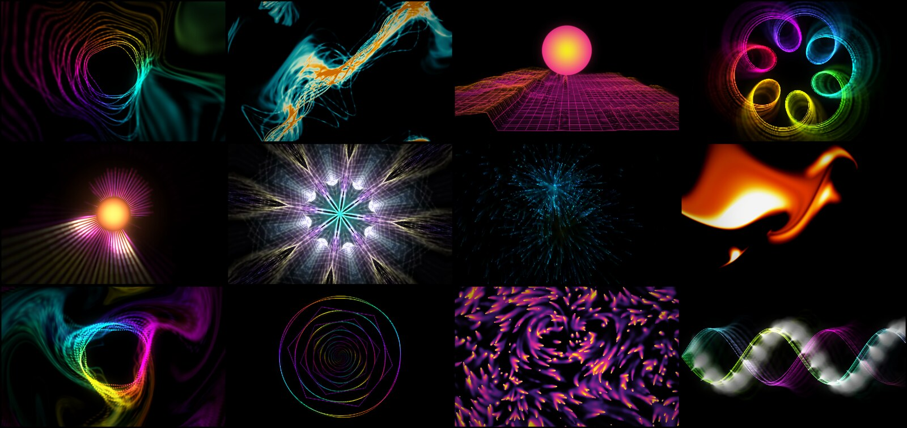
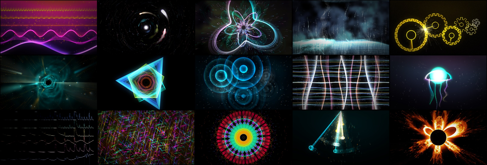

# Trance


A music visualizer for [Omarchy](https://omarchy.org). It listens to whatever
your speakers are playing and draws it: feedback tunnels in the spirit of
MilkDrop, flow fields and spectrum landscapes in the spirit of SoundSpectrum's
G-Force and WhiteCap, and plain analyzers when that's all you want. Every
preset can be changed while it runs, and the colors can follow your desktop
theme.






- **58 presets** built in, changing on the beat every 30 seconds (or held,
  shuffled, or picked from a searchable list). A change is not a cut: for a
  few seconds both presets run on the one picture, and the wave of one
  reshapes itself into the wave of the next.
- **A layer for every part of the sound.** Besides bass, mid and treble,
  formulas can follow six narrower ranges (`sub`, `low`, `lowmid`,
  `highmid`, `presence`, `air`), so each layer of a preset can move to its
  own. Fifteen presets are built that way, from Strata and Clockwork to
  Jellyfish, Corona and Seismograph.
- **Everything works on everything else.** Flow fields bend the picture,
  waves and bars throw particles, the particles ride the flow, backgrounds
  fill the dark, and one palette colors all of it.
- **Mash-ups and visitors.** `X` builds a new preset from parts of others:
  one's motion, another's layers, a third's colors. Small extras drop in over
  any preset for a while and leave again.
- **Listen to one app.** Follow everything that's playing, or only Spotify,
  or only your browser. The app keeps playing through your speakers; no
  virtual cables or rerouting.
- **Edit anything live.** Press `E`: every setting has a plain name, a
  slider, and an explanation when the pointer rests on it, and any number
  can instead be a formula of the music, such as `1.02 + 0.05*bass_att`.
  What you have changed since the last save is marked in the accent color. Layers of waves, bars, shapes, terrain and
  particles can be added, reordered and removed. Nothing is written until
  you save, and your presets are kept apart from the built-in ones.
- **Follows your theme.** Presets can use the theme's colors by name, and
  `T` recolors every preset with the theme's colors or one of eleven palettes. A
  theme switch shows up immediately.
- **Glass.** `G` makes black see-through, so Hyprland's blur and your
  desktop show behind the picture. A slider in the settings says how dark
  the glass is, from clear to solid.
- **Track titles** from whatever player is running (Spotify, a browser, mpv)
  when the song changes: in the corner, or written into the picture for the
  flow to carry off.

## Install

```sh
bin/install
```

This builds the package and installs it with pacman, after which Trance is in
the app launcher (`Super + Space`). To try it without installing:

```sh
bin/build && build/trance
```

It needs Omarchy's usual Qt 6 packages and `pipewire-audio`, all of which
Omarchy already has.

## Shortcuts

| Key | |
|---|---|
| `Space` | Next preset |
| `Backspace` | Previous preset |
| `R` | Random preset |
| `X` | Mash up a new preset from parts of others |
| `L` | Hold this preset, or let it change again |
| `P` or `/` | Browse and search presets |
| `E` | Edit this preset: its motion, layers and look |
| `S` | Settings: what applies to every preset |
| `D` | Debug overlay: preset name, frame rate, sound |
| `T` | Change the colors: theme, palettes, or the preset's own |
| `G` | Glass: let the desktop show through |
| `N` | Track titles: in the corner, in the picture, or off |
| `M` | Listen to the microphone instead |
| `+` `-` | More or less sensitive to the music |
| `F` or `F11` | Full screen (also a double-click) |
| `Ctrl+S` | Save the preset |
| `Ctrl+Shift+S` | Save it under a new name |
| `Ctrl+N` | New preset |
| `Ctrl+Z` `Ctrl+Shift+Z` | Undo, redo |
| `Esc` | Close a panel, or leave full screen |
| `?` | Show every shortcut |
| `Q` | Quit |

In the editor, double-click a setting's name to put it back to its default.

## Settings and presets

There are two panels, and they don't overlap:

- **Settings** (`S`) belong to the app and hold whatever preset is showing:
  what to listen to and how sensitively, how often presets change and how
  they blend, one palette for everything, glass, detail, and what is shown
  over the picture.
- **The preset editor** (`E`) changes the one preset on screen, and what it
  changes is saved with that preset: its motion, its layers, its look, or
  the whole thing as JSON. `Ctrl+Tab` moves between those.

Nothing is written over the picture unless you ask for it. Preset names on
a change are off by default (Settings > On screen), and `D` brings up a
debug overlay with the preset's name, frames per second and frame time, the
size the picture is drawn at, the graphics card, what is being listened to,
and the levels by the names formulas use (`bass`, `mid`, `treb`, `vol`,
`beat`).

Moving the pointer over the picture brings up a row of buttons for the same
things the keys do.

## What it listens to

By default, everything your speakers play. Under Settings (`S`) > Listen to
you can pick instead:

- **one application** (Spotify, Firefox, mpv…), so a video call or a
  notification sound doesn't move the picture. The application goes on
  playing through your speakers exactly as before: PipeWire lets Trance tap
  its stream, so there is nothing to reroute. If it stops playing, Trance
  waits for it.
- **one output or input device**, or the microphone. Only what is plugged in
  is offered, and only when there is a choice: with one set of speakers and
  one microphone, the list is just "everything" and "microphone".

The same from the command line, for a key binding or a script:

```sh
trance sources            # what there is to listen to right now
trance source Spotify     # follow Spotify only
trance source system      # back to everything
```

## Key bindings

A running Trance can be steered from the command line,
so it can be bound to keys in `~/.config/hypr/bindings.lua`:

```lua
o.bind("SUPER + ALT + period", "Trance: next preset", hl.dsp.exec_cmd("trance next"))
o.bind("SUPER + ALT + comma", "Trance: previous preset", hl.dsp.exec_cmd("trance previous"))
o.bind("SUPER + ALT + slash", "Trance: hold preset", hl.dsp.exec_cmd("trance lock"))
o.bind("SUPER + ALT + M", "Trance: mash-up", hl.dsp.exec_cmd("trance mashup"))
```

## Presets

[The manual](docs/manual.md) explains how to make one: how a frame is built,
what every setting is and does, and a preset written step by step. `trance
help manual` prints it.

A preset is a JSON file. Built-in ones are compiled into the app; yours are
in `~/.config/trance/presets/`. Saving a changed built-in makes your own copy
under the same name, and deleting that copy brings the original back.

```json
{
  "name": "My Preset",
  "palette": "theme",
  "feedback": { "decay": 0.96, "zoom": "1.02 + 0.03*bass_att" },
  "layers": [
    { "type": "wave", "shape": "circle", "color": "palette(t + time*0.1)" }
  ],
  "post": { "bloom": 0.8 }
}
```

`trance help format` prints the whole format: the variables (`bass`, `mid`,
`treb`, `beat`, `time`…), the functions, the five layer types, per-pixel
code, and the post effects.

## Command line

These need no window; `list`, `new`, `check` and `render` take `--json`.

```sh
trance list                         # every preset
trance show "Neon Tunnel"           # a preset's JSON
trance new "Night Drive" --from Horizon
trance check "Night Drive"          # every problem, by setting
trance render "Night Drive" -o look.png --sheet 6 --audio song.mp3
trance render Tidewater --then Starwake --sheet 12   # watch two presets change over
trance sources                      # what there is to listen to
trance skill install                # teach your coding agent to write presets
```

`render` draws a preset to a PNG, reacting to a built-in test loop or to an
audio file (which takes `ffmpeg`); `--sheet 6` tiles six moments into one
picture so you can see it move.

## Development

```sh
bin/build    # qmake6 + make into build/trance
bin/test     # the test suite, offscreen
```

## Where the ideas come from

From MilkDrop: the feedback loop, per-pixel code, custom waves and shapes,
motion vectors, darken-center, and mash-ups. From SoundSpectrum's G-Force
and WhiteCap: flow fields whose numbers are rolled anew each time they load,
color maps that bend and drift on their own, waves that morph into each
other, changes that glide instead of cut, particles that come and go by
chance (the visitors), track titles drawn into the picture, and the spectrum
as a landscape. Trance shares no code or presets with either.

`src/engine.cpp` is the renderer (plain OpenGL 3.3, no window needed),
`src/expr.cpp` the formula language (it runs formulas on the CPU and turns
the per-pixel ones into GLSL), `src/preset.cpp` the preset format, and
`src/audio.cpp` the analysis. The window is Qt Quick, in `src/*.qml`.

## License

MIT. Theme and language following are adapted from Omacut and Monologue by
David Heinemeier Hansson.
